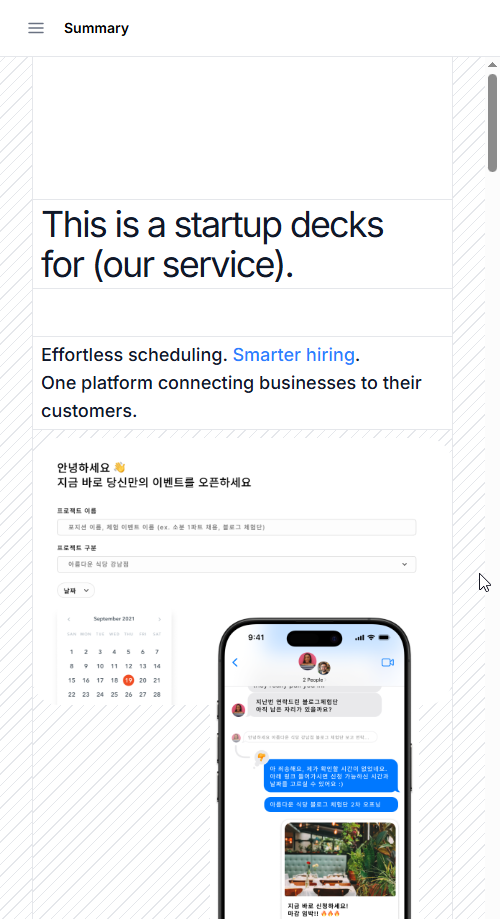
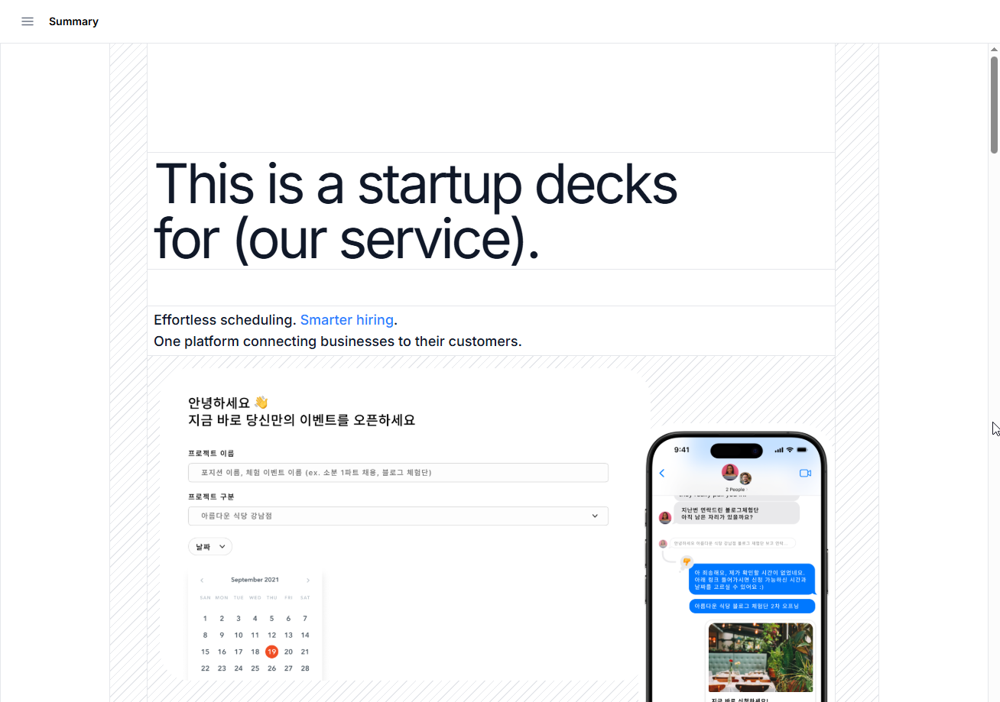
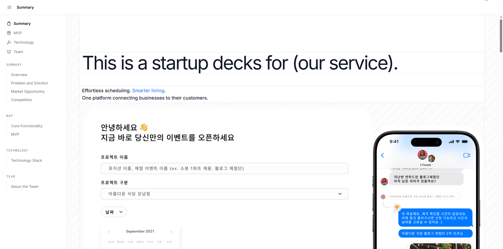

# StartUpDeck

A responsive startup pitch deck website, built as a hands-on exercise in adapting a content-rich interface to different screen sizes.

**The main focus of this project was learning responsive web design.** I spent a large part of the work thinking about how the same content should read and fit on mobile phones, tablets, and desktop screens—not just making the desktop layout smaller.

[View the live website](https://ria-startup-deck.vercel.app/)

## Learning focus

- Adapting layouts and content flow across mobile, tablet, and desktop breakpoints.
- Adjusting typography, spacing, and section proportions for different viewport widths.
- Keeping navigation and long-form presentation content readable on smaller screens.
- Practicing how to balance visual consistency with the space available on each device.

This is a learning and portfolio project. The startup content is presentation material used to practice the interface, rather than a claim that every described service feature is implemented.

## Presentation sections

- Overview
- Problem and Solution
- Market Opportunity
- Competition
- Core Functionality
- Technology Stack
- About the Team

## Responsive previews




## Repository contents

This repository preserves the static deployment files originally uploaded to Hostinger, including the HTML entry point, compiled JavaScript and CSS, images, and Apache configuration.

| Path | Purpose |
| --- | --- |
| `index.html` | Website entry point |
| `assets/` | Compiled JavaScript and CSS |
| `Overview.png` | Presentation image |
| `Summary-1.png`, `Summary-2.png` | Presentation images |
| `.htaccess` | Original Apache / Hostinger configuration |
| `vercel.json` | Static hosting and client-side route fallback on Vercel |
| `docs/screenshots/` | Reserved for device screenshots |

The supplied files are a **compiled static export**. The original editable components, package manifest, and build configuration are not included, so this repository does not currently provide an npm development or rebuild workflow.

## Preview locally

From the repository root, run:

```bash
python3 -m http.server 8000
```

Then open [http://localhost:8000](http://localhost:8000).

The command serves the supplied static files directly. It does not rebuild the application.

## Deployment

The site is currently hosted on [Vercel](https://ria-startup-deck.vercel.app/). This Vercel project is connected to the GitHub repository, and pushes to `main` automatically create production deployments. The static files are served from the repository root, with no build or dependency installation step required.

The original Hostinger website files are retained unchanged; the README, screenshot directory, and Vercel configuration are additions for documentation and hosting.

## Author

[Ria Choi](https://github.com/riiach)
